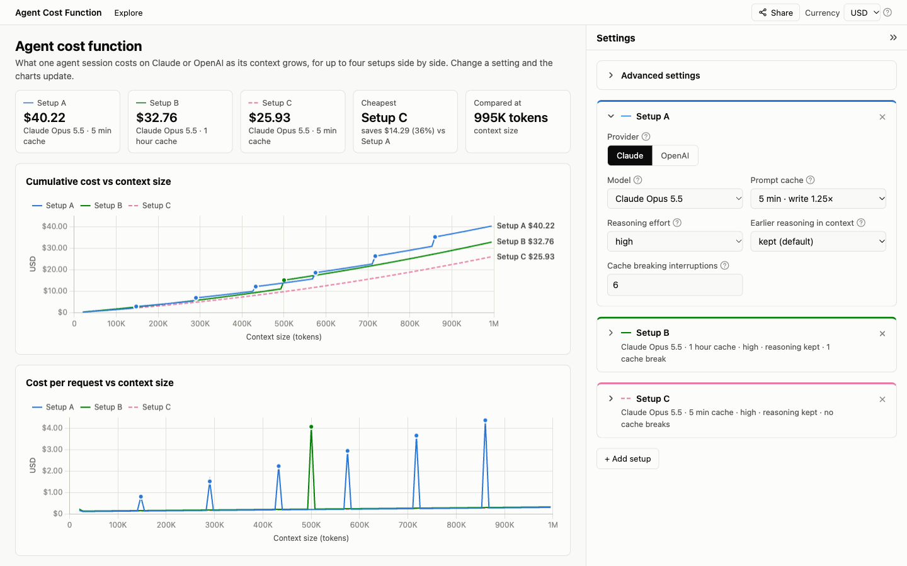

# Agent cost function

Models what one long-running LLM agent session costs as its context grows to 1M tokens. Compare up to four setups side by side, each on Claude or OpenAI with its own model, prompt cache, reasoning effort and cache breaking interruptions, on cumulative cost and cost per request.

Live: https://agent-cost-function.norbertlaszlo.com

## Prices

Prices, cache rules and model limits were checked on 2026-10-20 and are listed with their sources on the [Sources page](https://agent-cost-function.norbertlaszlo.com/sources/). How the costs are calculated is explained on the [How it is calculated page](https://agent-cost-function.norbertlaszlo.com/how-it-works/).

They come from the official documentation:

- https://platform.claude.com/docs/en/about-claude/pricing
- https://platform.claude.com/docs/en/about-claude/models/overview
- https://platform.claude.com/docs/en/build-with-claude/effort
- https://platform.claude.com/docs/en/build-with-claude/thinking
- https://developers.openai.com/api/docs/pricing
- https://developers.openai.com/api/docs/guides/prompt-caching
- https://developers.openai.com/api/docs/guides/reasoning
